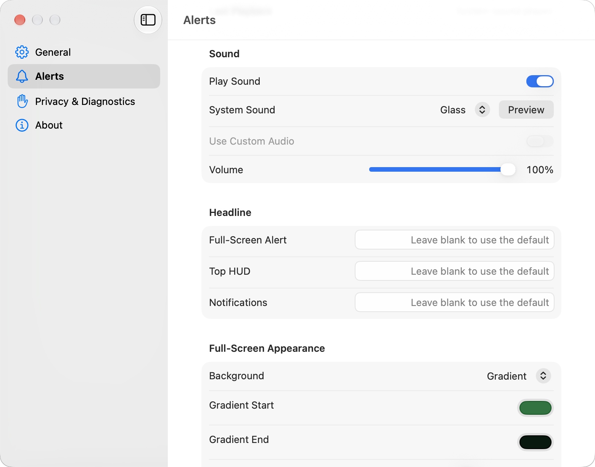

<p align="center">
  
</p>

<h1 align="center">CodexDone</h1>

<p align="center">
  A native macOS menu-bar app that reminds you when a Codex turn stops.
</p>

<p align="center">
  <strong>English</strong> · <a href="README.zh-CN.md">简体中文</a>
</p>

CodexDone connects to the official Codex Hooks in Desktop or CLI and keeps stopped turns ready for review in the menu bar.

Check your phone, grab a drink, or work on something else—there is no need to keep switching back to see whether Codex has stopped. CodexDone will let you know when it is time to return.

## Features

- Menu-bar review with unread count, conversation topic, project name, and reply preview
- Multiple visual alert styles with multi-display placement
- System notifications and built-in or custom alert sounds
- Custom alert headlines and full-screen appearance
- Optional blocking rules for submitted-message keywords and regular expressions, assistant-reply regular expressions, and projects

## Screenshots

### Main Page

<p align="center">
  
</p>

### Alert customization

<p align="center">
  
</p>

### Menu Bar

<p align="center">
  
</p>

## Environment

- Currently developed and tested on macOS 27
- Codex Desktop or CLI with Hooks support
- Xcode 27 when building from source

## Run from source

```bash
./script/build_and_run.sh --verify
```

On first launch:

1. Install Hooks from the onboarding window or **Settings → General**.
2. In Desktop, open **ChatGPT Settings → Hooks → User Configuration**; in CLI, enter `/hooks`.
3. Trust and enable `UserPromptSubmit` and `Stop`.

## Development

```bash
# Run all checks
./script/test.sh

# Build the Release configuration
xcodebuild -project CodexDone.xcodeproj -scheme CodexDone -configuration Release build
```

Licensed under the [MIT License](LICENSE).

Community: [LINUX DO](https://linux.do/)
