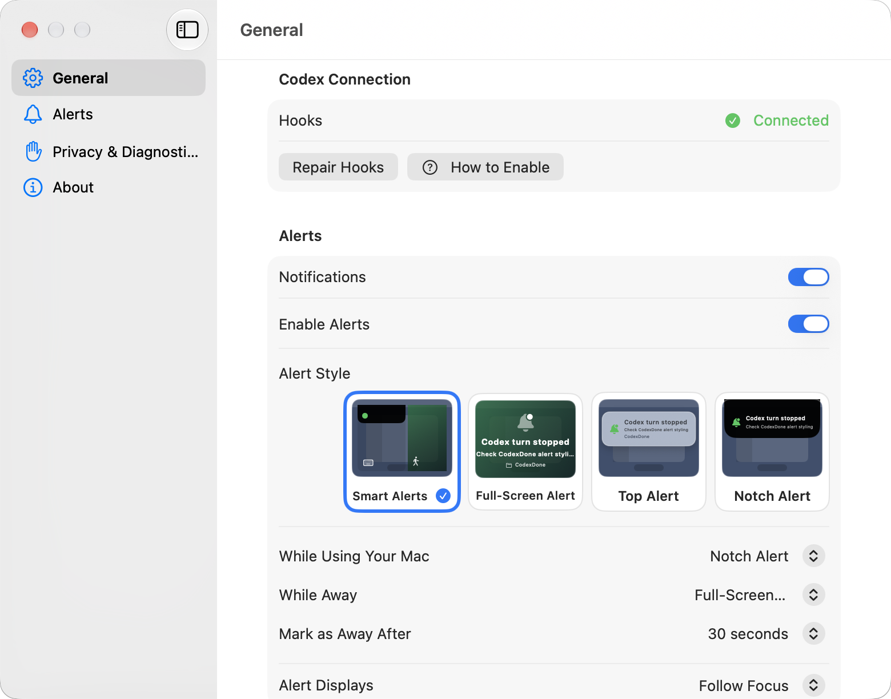
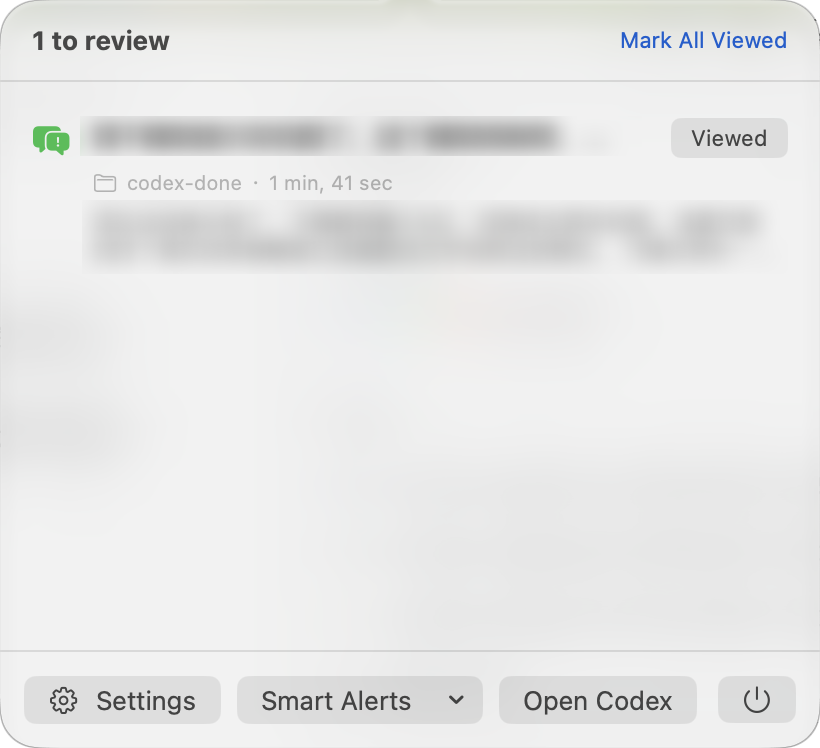

<p align="center">
  
</p>

<h1 align="center">CodexDone</h1>

<p align="center">
  A native macOS menu-bar app that reminds you when an AI coding agent finishes a turn.
</p>

<p align="center">
  <strong>English</strong> · <a href="README.zh-CN.md">简体中文</a>
</p>

CodexDone connects to Codex Desktop/CLI, Claude Code, and Pi Agent, and keeps finished turns ready for review in the menu bar.

Check your phone, grab a drink, or work on something else—there is no need to keep switching back to see whether Codex has stopped. CodexDone will let you know when it is time to return.

## Features

- Menu-bar review with unread count, conversation topic, project name, and reply preview
- Multiple visual alert styles with multi-display placement
- System notifications and built-in or custom alert sounds
- Custom alert headlines and full-screen appearance
- Optional blocking rules for submitted-message keywords and regular expressions, assistant-reply regular expressions, and projects

## Screenshots

### Main Page

<p align="center">
  
</p>

### Alert customization

<p align="center">
  
</p>

### Menu Bar

<p align="center">
  
</p>

## Environment

- Currently developed and tested on macOS 27
- Codex Desktop/CLI with Hooks support, Claude Code, or Pi Agent 1.5.2+
- Node.js 22.13+ for Pi extension development checks
- Xcode 27 when building from source

## Run from source

```bash
./script/build_and_run.sh --verify
```

On first launch:

1. Install Hooks from the onboarding window or **Settings → General**.
2. In Desktop, open **ChatGPT Settings → Hooks → User Configuration**; in CLI, enter `/hooks`.
3. Trust and enable `UserPromptSubmit` and `Stop`.

## Connect your agents

In **Settings → General → Connected agents**, connect each tool you use:

- **Codex:** install Hooks, then trust and enable `UserPromptSubmit` and `Stop` as described above.
- **Claude Code:** connect to merge those events into `~/.claude/settings.json`, preserving existing settings and hooks. Restart the Claude Code session.
- **Pi Agent:** connect to install `~/.pi/agent/extensions/codexdone.ts`, then run `/reload`. The extension alerts on `agent_settled`, after automatic retries and queued work finish.

Click a completed message to select its original **iTerm2 window, tab, and split pane**. This uses `ITERM_SESSION_ID` inherited by the local agent process. For Codex CLI using a shared background server, CodexDone captures the active iTerm2 pane when you submit a prompt with iTerm2 in front. Allow CodexDone to control iTerm2 when macOS asks. Existing records without a terminal ID cannot locate a terminal session; start a new turn after updating. Missing targets show an error instead of opening the desktop app. SSH and tmux pane routing are not included.

The notch alert collapses after six seconds, then its compact indicator disappears after two seconds. Unread messages remain in the menu bar.

When **Alcove** is running, CodexDone automatically uses a floating card below the top 160 points of the screen. The entire card remains clickable. This is a coexistence mode, not an Alcove plugin; manually expanded Alcove panels are not tracked.

Integration references: [Claude Code hooks](https://code.claude.com/docs/en/hooks), [Pi extensions](https://github.com/earendil-works/pi/blob/main/packages/coding-agent/docs/extensions.md), [iTerm2 scripting](https://iterm2.com/documentation-scripting.html).

## Development

### Build on GitHub

Fork this repository and enable Actions in your fork. Pushing a branch runs **Build macOS app** on an Apple Silicon Mac with Xcode 27.2. You can also start it from **Actions → Build macOS app → Run workflow**.

The workflow runs `script/test.sh`, verifies the Release bundle, and uploads `CodexDone-macOS27-arm64`. Download that artifact from a successful run, extract `CodexDone.app.zip`, and move the app to Applications. Test results and UI screenshots are available in `test-results`; artifacts are retained for seven days.

The app requires macOS 27 on Apple Silicon. This development build is ad-hoc signed and not notarized; macOS may require **System Settings → Privacy & Security → Open Anyway** on first launch. Your Mac does not need Xcode to run it.

### Local checks

```bash
# Run all checks
./script/test.sh

# Build the Release configuration
xcodebuild -project CodexDone.xcodeproj -scheme CodexDone -configuration Release build
```

Licensed under the [MIT License](LICENSE).

Community: [LINUX DO](https://linux.do/)
