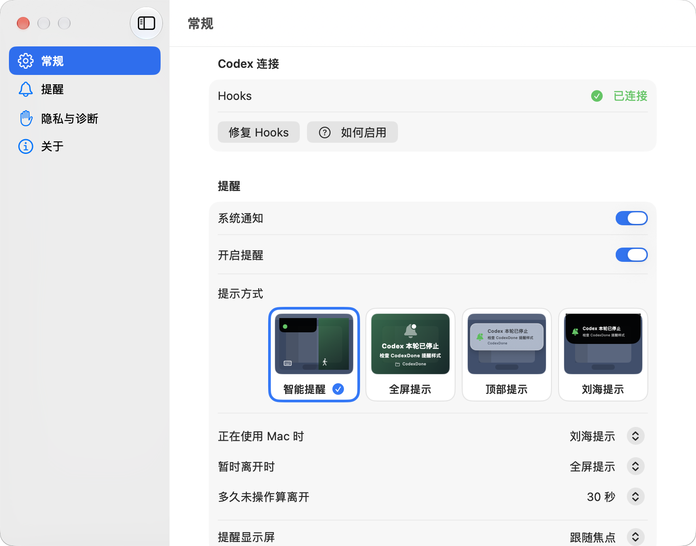
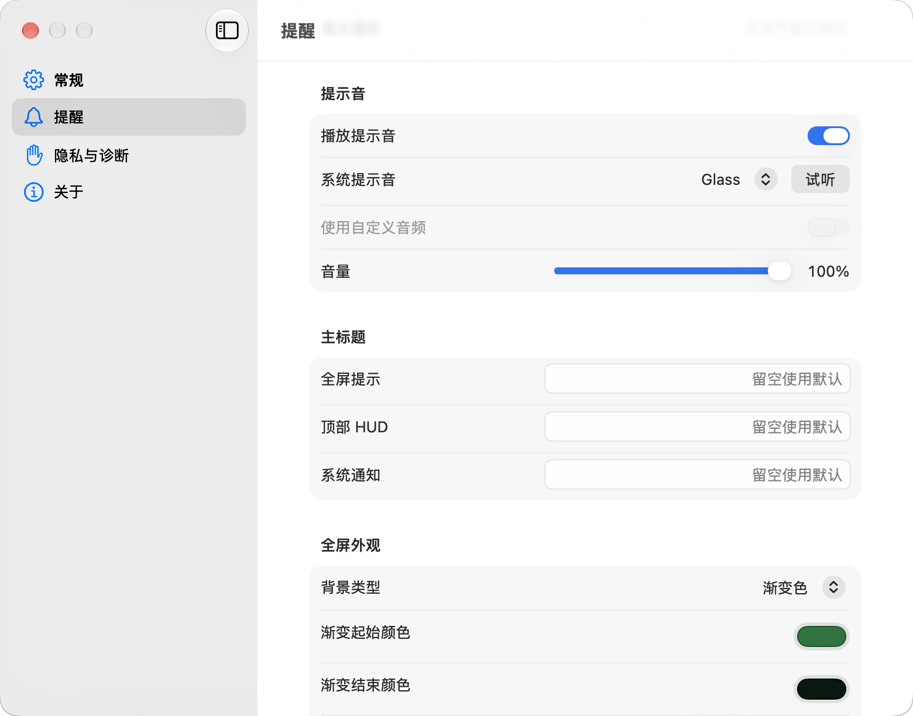

<p align="center">
  
</p>

<h1 align="center">CodexDone</h1>

<p align="center">
  当 Agent 本轮结束时，提醒你回来查看的原生 macOS 菜单栏工具
</p>

<p align="center">
  <a href="README.md">English</a> · <strong>简体中文</strong>
</p>

CodexDone 支持 Codex Desktop/CLI、Claude Code 和 Pi Agent，在菜单栏中集中显示待查看对话。

去看手机、喝杯水，或者忙点别的，不用再反复切回 Codex 看它停没停——本轮停止时，CodexDone 会提醒你回来查看。

## 功能

- 菜单栏待查看记录、未读数量、聊天主题、项目名和回复预览
- 支持多种视觉提示方式与多显示器选择
- 支持系统通知、内置或自定义提示音
- 支持自定义提醒标题和全屏外观
- 可按发送内容关键词或正则、回复内容正则以及项目设置屏蔽规则

## 界面预览

### 主页面

<p align="center">
  
</p>

### 提醒自定义

<p align="center">
  
</p>

### 菜单栏

<p align="center">
  
</p>

## 运行环境

- 当前开发与测试环境：macOS 27
- 支持 Hooks 的 Codex Desktop/CLI、Claude Code 或 Pi Agent 1.5.2+
- 从源码构建时使用 Xcode 27

## 从源码运行

```bash
./script/build_and_run.sh --verify
```

首次启动时：

1. 在初始化引导或“**设置 → 常规**”中安装 Hooks。
2. Desktop 打开“**ChatGPT 设置 → 钩子 → 用户配置**”；CLI 输入 `/hooks`。
3. 分别信任并开启 `UserPromptSubmit` 与 `Stop`。

## 接入其他 Agent

在 **设置 → 常规 → 工具连接** 中分别连接：

- **Claude Code**：将开始与停止事件合并到 `~/.claude/settings.json`，保留原有设置和 Hooks；连接后重新启动会话。
- **Pi Agent 1.5.2+**：安装 `~/.pi/agent/extensions/codexdone.ts`，然后在 Pi 中执行 `/reload`。自动重试和排队任务全部结束后才提醒。
- **Codex Desktop/CLI**：沿用原有 Hooks 安装、信任和启用流程。

点击完成消息，可选中对应的 **iTerm2 窗口、标签页和分屏**。本地 Agent 需继承 iTerm2 的 `ITERM_SESSION_ID`；首次跳转时允许 macOS 的自动化授权。旧记录没有终端标识，从新一轮消息开始支持定位。当前不包含 SSH 和 tmux 内部分屏定位。

灵动岛展开 6 秒后收起，小标志再停留 2 秒后消失；未读消息继续留在菜单栏。

开发检查需要 Node.js 22.13+，可单独运行 `node script/test_pi_extension.mjs`。

## 开发

### 使用 GitHub 云端编译

Fork 仓库并在自己的仓库中启用 Actions。推送分支后，**Build macOS app** 会在安装 Xcode 27.2 的 Apple Silicon Mac 上运行。也可从 **Actions → Build macOS app → Run workflow** 手动启动。

流程执行 `script/test.sh`、验证 Release 应用，然后上传 `CodexDone-macOS27-arm64`。从成功的运行页面下载该产物，解压其中的 `CodexDone.app.zip`，将应用移入“应用程序”。测试结果和界面截图保存在 `test-results`，产物保留七天。

应用需要 Apple Silicon 和 macOS 27。这是采用临时签名、未经公证的开发版，首次打开时可能需要在“**系统设置 → 隐私与安全性 → 仍要打开**”中放行。本机运行应用不需要安装 Xcode。

### 本地检查

```bash
# 运行全部检查
./script/test.sh

# 构建 Release
xcodebuild -project CodexDone.xcodeproj -scheme CodexDone -configuration Release build
```

本项目采用 [MIT License](LICENSE)。

社区：[LINUX DO](https://linux.do/)
