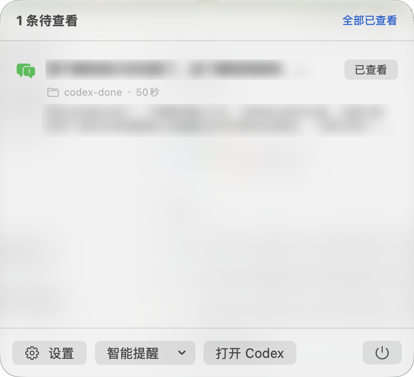

<p align="center">
  
</p>

<h1 align="center">CodexDone</h1>

<p align="center">
  当 Codex 本轮停止时，提醒你回来查看的原生 macOS 菜单栏工具
</p>

<p align="center">
  <a href="README.md">English</a> · <strong>简体中文</strong>
</p>

CodexDone 接入 Codex Desktop 或 CLI 的官方 Hooks，并在菜单栏中保留本轮停止后的待查看对话。

去看手机、喝杯水，或者忙点别的，不用再反复切回 Codex 看它停没停——本轮停止时，CodexDone 会提醒你回来查看。

## 功能

- 菜单栏待查看记录、未读数量、聊天主题、项目名和回复预览
- 支持多种视觉提示方式与多显示器选择
- 支持系统通知、内置或自定义提示音
- 支持自定义提醒标题和全屏外观
- 可按发送内容关键词或正则、回复内容正则以及项目设置屏蔽规则

## 界面预览

### 主页面

<p align="center">
  
</p>

### 提醒自定义

<p align="center">
  
</p>

### 菜单栏

<p align="center">
  
</p>

## 运行环境

- 当前开发与测试环境：macOS 27
- 支持 Hooks 的 Codex Desktop 或 CLI
- 从源码构建时使用 Xcode 27

## 从源码运行

```bash
./script/build_and_run.sh --verify
```

首次启动时：

1. 在初始化引导或“**设置 → 常规**”中安装 Hooks。
2. Desktop 打开“**ChatGPT 设置 → 钩子 → 用户配置**”；CLI 输入 `/hooks`。
3. 分别信任并开启 `UserPromptSubmit` 与 `Stop`。

## 开发

```bash
# 运行全部检查
./script/test.sh

# 构建 Release
xcodebuild -project CodexDone.xcodeproj -scheme CodexDone -configuration Release build
```

本项目采用 [MIT License](LICENSE)。

社区：[LINUX DO](https://linux.do/)
